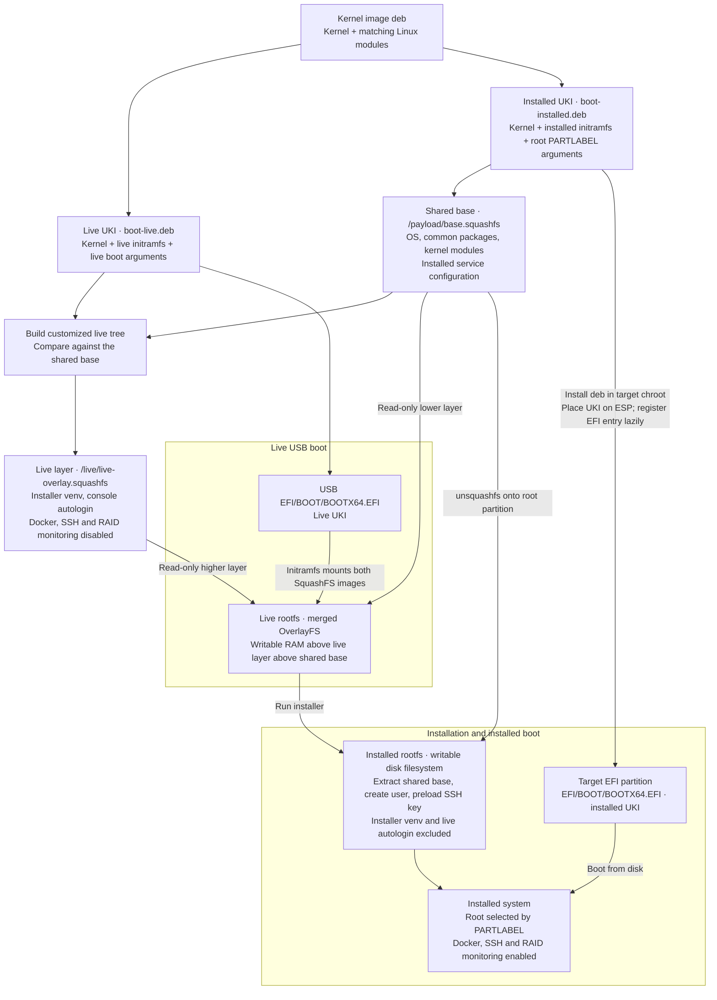

# Ubuntu UKI LiveUSB

Build a custom Ubuntu kernel, two root filesystems and two UKIs, then assemble a UEFI LiveUSB ISO. Boot the live system to install the server SquashFS and its prebuilt UKI onto a target disk.

```text
ubuntu_uki_iso/
  kernel/     source download, configuration and kernel deb build
  uki/        kernel-deb-to-UKI/boot-package build and boot parameters
  rootfs/     shared live/installed bootstrap and SquashFS builder
  iso/        hybrid UEFI ISO assembly and verification
  installer/  payload validation/deployment, disk checks and optional RAID handling
  qemu/       live boot and installation checks against virtual disks
```

## Setup

Python 3.11 or newer is required. Builders check dependencies and report missing packages; they do not install host packages.

```bash
python3 -m venv .venv
.venv/bin/pip install -e '.[dev]'
source .venv/bin/activate
```

| Binary | Entry point | Result |
|---|---|---|
| `ubuntu-uki-nvidia` | `nvidia.build:main` | Offline NVIDIA open module deb for custom headers |
| `ubuntu-uki-kernel` | `kernel.build:main` | Kernel image and headers debs |
| `ubuntu-uki-build` | `uki.build:main` | UKI EFI, initramfs and boot deb |
| `ubuntu-uki-rootfs` | `rootfs.build:main` | Rootfs and SquashFS images |
| `ubuntu-uki-image` | `iso.build:main` | Hybrid LiveUSB ISO |
| `ubuntu-uki-test` | `qemu.harness:main` | Boot and installation checks in QEMU/OVMF |
| `ubuntu-uki-install` | `installer.cli:main` | Install the payload on a target disk |

The build binaries require `--temp-dir`. Use the same directory throughout. A rootfs build requires root to preserve file ownership. ISO assembly uses mtools and needs no mounts or root privileges.

`build/Dockerfile` provides build dependencies. For local builds install its kernel dependencies and:

```bash
sudo apt-get install apt dpkg mmdebstrap ubuntu-keyring squashfs-tools kmod systemd \
  python3-pip python3-setuptools python3-wheel \
  dracut systemd-ukify systemd-boot-efi mdadm dmsetup zstd xorriso dosfstools mtools
```

Each binary calls its owning submodule directly. Shared artifact validation, GPT/PE parsing, settings and errors live at the package root. Stage-specific code and configuration live in their respective submodules. Reinstall the project after changing entry points: `python3 -m pip install --no-deps -e .`.

## Build the ISO

```bash
ubuntu-uki-kernel --temp-dir out --jobs 32
ubuntu-uki-build --temp-dir out --mode live
ubuntu-uki-build --temp-dir out --mode installed
sudo "$PWD/.venv/bin/ubuntu-uki-rootfs" --temp-dir out --mode installed --boot-deb out/uki/boot-installed.deb
sudo "$PWD/.venv/bin/ubuntu-uki-rootfs" --temp-dir out --mode live --boot-deb out/uki/boot-live.deb
ubuntu-uki-image --temp-dir out
```

The build order is **kernel → UKIs and boot packages → installed/shared base → live layer → ISO**. The UKI builder selects the image deb matching `kernel/release`; ambiguous inputs are rejected. It accepts `--kernel-deb` for an explicit input and `--mode live` or `--mode installed`.

The live and installed UKIs contain the same kernel, but different initramfs configuration and boot arguments. Both root filesystems use the same base stored once on the ISO:



Each UKI build also emits `out/uki/boot-live.deb` or `out/uki/boot-installed.deb`. Each package contains `/boot/efi/EFI/BOOT/BOOTX64.EFI`, the matching `/usr/lib/modules/<release>/` tree, and release/mode metadata. Both packages are owned by root and depend on `kmod`. The installed package also depends on `efibootmgr` and `util-linux`, and includes a `postinst` script that registers the EFI boot entry when explicitly requested. Rootfs builds set `UBUNTU_UKI_REGISTER_EFI=0`, so they never change firmware entries.

The rootfs builder bootstraps Ubuntu and installs the corresponding boot package with `dpkg --root=<target> -i`, then runs `depmod` against that target. It requires `--boot-deb /path/to/boot.deb`, defaults to installed mode, accepts `live` or `installed`, and compresses each image as part of its build. It does not discover boot packages automatically. Build installed mode first: its SquashFS is the shared base. Live mode builds its customized tree and compares it with that exact base, publishing only changed files in `live/live-overlay.squashfs`. Deleted files become OverlayFS whiteouts. The live layer records the base SHA256; ISO assembly rejects stale or mismatched pairs. Uncompressed build trees are retained for inspection.

ISO assembly extracts and validates the UKIs from the boot packages rather than consuming loose EFI outputs. SquashFS excludes EFI partition contents; the installer copies the packaged installed UKI onto the target ESP at the same path tracked by dpkg.

Run the commands above in order inside the provided build container; there is no combined build command.

The kernel builder extracts the Ubuntu binary `linux-source-7.0.0` package and runs `make bindeb-pkg`. It records the actual upstream release rather than inferring it from Ubuntu's package series. The fixed hardware profile is explained in [docs/kernel-workstation.md](docs/kernel-workstation.md).

Both profiles include `linux-firmware-nvidia-graphics` for the declared NVIDIA GPU support, rather than the `linux-firmware` metapackage. The target's Intel I226-V (`igc`), NVMe and AHCI drivers declare no external firmware blobs, and the target has no Wi-Fi adapter. This is a fixed package policy in `rootfs/config.py`; builds do not detect hardware on the build host. Add the relevant vendor firmware package when targeting different hardware. The validated slim image in `out/server-liveusb-slim` reduces the installed SquashFS from 841.8 MiB to 278.2 MiB and the ISO from 1,204.8 MiB to 641.3 MiB. Installation and installed boots with and without the data array passed; your configured SSH-key preload remains included.

Both rootfs profiles use Netplan with the NetworkManager renderer and automatic wired connections. NetworkManager sends DNS configuration to systemd-resolved; networkd and its socket/wait-online units are masked. The Netplan configuration is written to `/etc/netplan/01-network-manager-all.yaml`.

Both rootfs profiles get Ubuntu OS metadata from `base-files` and matching runtime modules installed from their boot packages. Kernel maintainer scripts are not run. The installer runs as `ubuntu-uki-install` or `python3 -m ubuntu_uki_iso.installer.cli` and uses direct subprocess calls, with read-only dry-run planning and explicit confirmation before writes. The live rootfs carries the installer in `/opt/ubuntu-uki-installer`, created using `python3-venv` inside the target rootfs. Its runtime-only wheel is built on the host and installed offline; `/usr/local/bin/ubuntu-uki-install` links to the venv console entry point. Both modes use one `BASE_PACKAGES` list in `rootfs/config.py`, including NVIDIA firmware, Docker, SSH, and the same recovery tools. Live adds only `python3-venv` and the installer venv; automatic Docker, SSH, and RAID-monitor startup is disabled there. Installed mode enables those server services. Kernel headers remain build artifacts for compiling external drivers offline. The rootfs does not include custom headers, DKMS or compiler packages. The `nvidia` submodule builds precompiled NVIDIA open kernel modules as a kernel-specific deb. Installing that deb and matching userspace/firmware packages during image creation is a separate integration step; NVIDIA packages are not added to rootfs automatically. UKI generation tools remain outside the rootfs. Machine IDs and SSH keys are cleared; installed systems generate fresh SSH host keys on first boot.

Dracut uses `hostonly=no` and explicit driver/module lists. UKIs embed build-host OS metadata, their kernel release and mode-specific command line. Configure packages/services in `rootfs/config.py`, kernel overrides in `kernel/config.py`, and boot flags and dracut policy in `uki/config.py`. `live_command_line()` selects the ISO by volume label; `installed_command_line()` selects `settings.ROOT_LABEL` using GPT PARTLABEL.

Outputs:

```text
out/kernel/linux-image-*.deb
out/kernel/linux-headers-*.deb
out/uki/boot-live.deb
out/uki/boot-installed.deb
out/rootfs-live/
out/rootfs-installed/
out/uki/BOOTX64.EFI
out/uki/uki.efi
out/iso/live/live-overlay.squashfs
out/iso/payload/base.squashfs
out/ubuntu_uki_iso.iso
```

The ISO contains:

```text
/boot/efi.img              FAT32 image with /EFI/BOOT/BOOTX64.EFI (live UKI)
/live/live-overlay.squashfs   live installer venv and configuration differences
/payload/base.squashfs   shared base system, including runtime modules
/payload/uki.efi           installed UKI used for verification
/payload/boot-installed.deb installed UKI/modules package with EFI postinst
/payload/manifest.json     kernel release and SHA256 checksums
```

Live boot mounts `/payload/base.squashfs` read-only, adds `/live/live-overlay.squashfs` as the higher read-only layer, then places a writable RAM overlay above the union. The layer is mounted directly; it is not unpacked. Installation extracts only the shared base, so neither console autologin nor the installer venv is copied to the installed system. The live UKI includes a dracut pre-mount hook for this layout; older live UKIs cannot boot it.

The FAT image is also appended as a GPT EFI System Partition for USB firmware. An El Torito UEFI entry supports optical/virtual CD boot. This follows [xorriso's hybrid partition options](https://www.gnu.org/software/xorriso/man_1_xorrisofs.html). Assembly checks both boot records, the ISO volume label, matching kernels/modules/command lines, embedded payload hashes and the actual EFI contents of both ESP copies before replacing the output.

`SOURCE_DATE_EPOCH` fixes SquashFS timestamps and the ISO modification timestamp. Archive package versions and other build metadata can still vary; byte-for-byte reproducibility is not guaranteed.

## Build NVIDIA kernel modules offline

The kernel build emits a matching `linux-headers-*.deb`. Supply that package and a local release source tree from [NVIDIA/open-gpu-kernel-modules](https://github.com/NVIDIA/open-gpu-kernel-modules) to the independent builder:

```bash
ubuntu-uki-nvidia --temp-dir out \
  --driver-version 595.80 \
  --headers-deb out/kernel/linux-headers-7.0.14-xiahualab-iso_7.0.14-1_amd64.deb \
  --source-dir /path/to/open-gpu-kernel-modules-595.80 \
  --jobs 16
```

`--driver-version` selects the exact release expected from the local source tree; mismatches fail before compilation. Omit it to use the version recorded in `version.mk`. Different releases need their matching local source tree, userspace driver and GSP firmware; choosing a version does not download it.

Run `python3 -m ubuntu_uki_iso.nvidia.build` as an alternative to the installed entry point. Build-host dependencies are `build-essential libelf-dev kmod dpkg-dev`; use a GCC toolchain matching the custom kernel. The builder performs no downloads and needs no root privileges. It extracts headers and copies sources into scratch space, explicitly selects the target kernel rather than the running host kernel, and verifies every module's kernel release, driver version and name before publishing.

The output is `out/nvidia/nvidia-modules-<kernel-release>_<driver-version>-1_amd64.deb`. It contains `nvidia`, `nvidia-modeset`, `nvidia-drm` and `nvidia-uvm` under `/usr/lib/modules/<kernel-release>/updates/nvidia`, licensing and build metadata, and install/remove hooks for `depmod`. It depends on the corresponding live or installed boot deb. It contains no headers, compiler, DKMS, userspace driver or GSP firmware. Modules are unsigned, consistent with the current Secure Boot-disabled boot chain. No modules are loaded on the build host.

NVIDIA requires userspace drivers and GSP firmware from the same NVIDIA release as the modules; [upstream's build instructions](https://github.com/NVIDIA/open-gpu-kernel-modules#how-to-build) describe this requirement. Existing `linux-firmware-nvidia-graphics` alone does not establish that match. The new deb is not yet consumed automatically by the rootfs or ISO builders. Actual GPU operation must be checked on the NVIDIA server; QEMU without GPU passthrough cannot validate it.

## Boot and install

The live initramfs includes `usbhid` and `hid_generic` so USB keyboards work before the root filesystem mounts. Live boot keeps serial output at 115200 baud and selects the physical monitor (`console=tty0` last) as the primary console. `rd.debug`, `rd.shell` and `systemd.show_status=1` expose early boot progress and permit a dracut shell when boot fails. These diagnostics do not enable Nouveau or an NVIDIA GPU driver.

Write `out/ubuntu_uki_iso.iso` as a raw image to the entire USB device using an image writer. Boot its UEFI entry. The live system opens a root console and mounts the live rootfs with a temporary writable overlay. The generated EFIs are unsigned; use firmware with Secure Boot disabled until you provide signed images. BIOS boot is not supported.

From the live console, inspect the disks with `lsblk`, then preview the install:

```bash
ubuntu-uki-install
# Apply after reviewing the disk and plan; asks for typed confirmation:
ubuntu-uki-install --apply
```

**Applying erases and repartitions the selected root disk.** It creates a 1 GiB FAT32 ESP and a labeled ext4 root partition, extracts the installed SquashFS, writes fstab using filesystem UUIDs, mounts the ESP and recursively binds `/dev`, `/proc`, and `/sys` into the target with slave propagation, then runs `dpkg -i` in a chroot to install `boot-installed.deb`. The package writes `/boot/efi/EFI/BOOT/BOOTX64.EFI`; its `postinst` creates the firmware entry using `UBUNTU_UKI_REGISTER_EFI=1`, `UBUNTU_UKI_EFI_DISK=<target-disk>`, and `UBUNTU_UKI_EFI_PART=1`. Registration leaves an existing entry with the exact configured label alone; otherwise it uses `efibootmgr --create-only`. BootOrder and BootNext remain unchanged. Select the entry from the firmware boot menu to boot it. Temporary chroot mounts are cleaned up even on failure. No initramfs rebuild or compilation happens on the target. Reboot, remove the USB, and select the installed entry in the firmware boot menu.

The installer locates `/payload` on the mounted ISO automatically. An explicit `--payload /path/base.squashfs` requires `boot-installed.deb`, `uki.efi`, and `manifest.json` beside that file. Manifest version 2 checksums all three payload artifacts; the UKI extracted from the deb must also match `uki.efi`. Checksums, release, modules and boot parameters are validated before partitioning. Checksums detect corruption or mismatched artifacts; they are not signatures.

The installed `/mnt/raid0` ext4 mount uses `defaults,noatime,nodiratime,data=writeback,barrier=0,commit=600,nofail,x-systemd.device-timeout=10s`, matching the existing array's mount policy while allowing boot without the array. The filesystem is identified by UUID, and the missing-device wait is capped at 10 seconds. Edit `DATA_MOUNT_OPTIONS` in `installer/config.py` to change this policy. The installer's temporary verification mount remains `ro,norecovery`.

By default, the installer discovers one non-removable, writable SSD around 1 TB and exactly eight non-removable, writable HDDs around 8 TB, using `lsblk --bytes` and a ±10% capacity range. This matches a 931.5 GiB NVMe and eight 7.3 TiB HDDs. More than one root candidate or an incomplete data-disk set stops the installation. The detected devices and proposed actions are printed before confirmation; the selected root disk is repartitioned and reformatted on every apply run.

Default `--raid auto` preserves a matching existing RAID0 array, leaving it mounted if already mounted. If every expected HDD is blank, it creates RAID0 and formats the array as ext4 after confirmation. Partial/mixed arrays, unexpected array identity/geometry, and non-RAID filesystem or partition-table signatures are refused. Existing data drives are never automatically wiped. Disk-size bounds are configured in `installer/config.py`; explicit `--root-disk` and `--data-disks` override capacity discovery for other hardware.

Existing RAID support remains optional: `--raid reuse --data-disks "..."` checks the configured array identity before assembling it. `--raid create` requires blank members and explicit apply/confirmation. Edit array settings in `installer/config.py` for your hardware. With `--raid none`, no data array is managed. After disk confirmation, the installer prompts for a username and a hidden initial password (entered twice), then creates that account with a home directory and sudo access. Sudo requires the account password. Set `SSH_PUBLIC_KEY` in `installer/config.py` to preload one SSH public key after account creation; `.ssh` uses mode 0700 and `authorized_keys` uses mode 0600, both owned by the new account. Existing keys are preserved and duplicate lines are skipped. Rebuild the live rootfs and ISO after changing this setting. Credentials are collected before formatting. Automation can use `--username NAME --password-file PATH` with a private file (mode 0600); `--assume-yes` only skips disk confirmation. Dry runs do not request credentials.

## Validation

```bash
pytest
ruff check ubuntu_uki_iso tests
ruff format --check ubuntu_uki_iso tests
ubuntu-uki-test --temp-dir out --test live-boot
ubuntu-uki-test --temp-dir out --test install
```

The VM uses Q35, paired OVMF CODE/VARS files, a USB mass-storage LiveUSB, one 1 TB NVMe SSD, eight 8 TB SATA HDDs on two AHCI controllers, and an e1000e NIC with user-mode DHCP/NAT. All disks are sparse qcow2 files; no host block device is attached. Install `qemu-system-x86 qemu-utils ovmf expect` to run it. KVM is used when accessible, otherwise TCG.

Scenarios cover live boot and networking, refusal of blank disks in reuse mode, default automatic creation planning, a dry run with an existing array, and an actual installation reusing that array. Installation checks BootOrder/BootNext preservation, then boots the installed system with USB removed, first with the data array and then without it to exercise `nofail`. Device selection uses the installer's default capacity/rotation discovery. Firmware device selection uses [QEMU bootindex](https://www.qemu.org/docs/master/system/bootindex.html); the installer does not reorder firmware entries.

The existing-array fixture formats only 1 GiB of the 64 TB virtual RAID device to keep writes modest; it exercises reuse, not creation of a full-size filesystem. Dry-run/refusal checks compare the first and last 4 MiB of each disk, including partition and md metadata, rather than hashing 65 TB. These are metadata checks, not whole-disk byte comparisons. Guest scripts use shell assertions and exit statuses, with transcripts in `<temp-dir>/vm-logs/`.

Installed UKIs include the serial console so the VM can log in as the installed test user. Rebuild both UKIs, boot packages, rootfs images and the ISO after installer or boot-policy changes; old images do not include current code.

Tests exercise real SquashFS compression/extraction and, when ISO tools are available, real xorriso assembly, optical/USB boot records, exact payload contents, module/release consistency, corruption rejection and direct EFI deployment. Disk mutations in unit tests use recording commands and temporary directories. QEMU tests use virtual disk files only.

A real kernel build and both UKI builds completed previously under `out/kernel-uki-validation` (release `7.0.14-xiahualab-iso`). The ISO assembly integration test passed with synthetic root filesystems and PE fixtures using locally extracted xorriso/mtools. Both mmdebstrap rootfs builds completed under `out/rootfs-inspection`: live is 133.7 MiB and installed is 841.8 MiB compressed. Content checks passed for package state, kernel modules, networking, services, machine identity cleanup, EFI exclusion from SquashFS, and the live installer venv (including its chroot help command); details are in `out/rootfs-inspection/inspection.json`. The base installed image has no regular login account; the installer creates it during installation. The full OVMF/TCG suite passed against the corrected ISO in `out/qemu-validation-fixed`: live USB boot/networking, blank-disk refusal, creation planning, dry-run metadata preservation, installation with unchanged BootOrder/BootNext, and installed NVMe boots both with and without the data array. The run found and fixed the GPT label argument syntax and ESP formatting order. Logs and the tested ISO checksum are recorded in `out/qemu-validation-fixed/validation.json`.

Shared artifact validation, GPT/PE parsing, settings and errors live directly under `ubuntu_uki_iso/`. QEMU uses direct subprocess calls in `qemu/harness.py`, and ISO boot-report validation lives in `iso/validation.py`.

Commands print directly to stdout, with warnings and errors on stderr. Redirect output in the shell to save logs, for example `ubuntu-uki-image --temp-dir out >build.log 2>&1`.

All build and VM commands require an explicit `--temp-dir`; no workspace discovery or workspace environment variable is used. To inspect a real UKI in the parser test, pass `pytest --uki-file /path/to/BOOTX64.EFI`.

The shared-base images were rebuilt from scratch with mmdebstrap under `out/server-liveusb-shared`: installed is 318.3 MiB, live is 324.2 MiB, and the ISO is 879.5 MiB. All shared base packages have matching versions in both images. All five OVMF/TCG scenarios passed, including installation and installed NVMe boots with and without the data array. The live check also verifies that Docker and SSH are installed but inactive. Content checks, guest logs, and the ISO checksum are recorded in `out/server-liveusb-shared/validation.json` and `SHA256SUMS`. Earlier images retain their original package profiles and sizes.

The layered ISO in `out/server-liveusb-layered` is 561.3 MiB, down from 879.5 MiB. It reuses the tested 318.3 MiB base and adds a 6.05 MiB live layer with no duplicated kernel modules or firmware. All five OVMF/TCG scenarios passed, including installed boots with and without data disks and checks that installed systems have neither the installer venv nor live autologin. See `out/server-liveusb-layered/validation.json` and `SHA256SUMS`. The workspace-root `ubuntu_uki_iso.iso` is a verified copy of this image.

The NVIDIA module builder was validated with upstream 615.78.08 against the actual `linux-headers-7.0.14-xiahualab-iso` deb. All four modules compiled and passed version/vermagic checks. `depmod` against the kernel Module.symvers reported no symbol errors, and a dry-run `modprobe` resolved the dependency chain alongside the existing boot deb. The runtime deb and report are under `out/nvidia-validation`; no host drivers were installed or loaded, and no GPU runtime test was performed.
